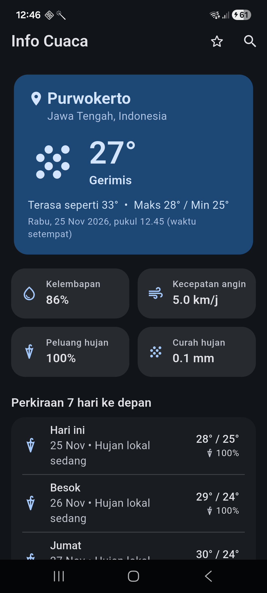
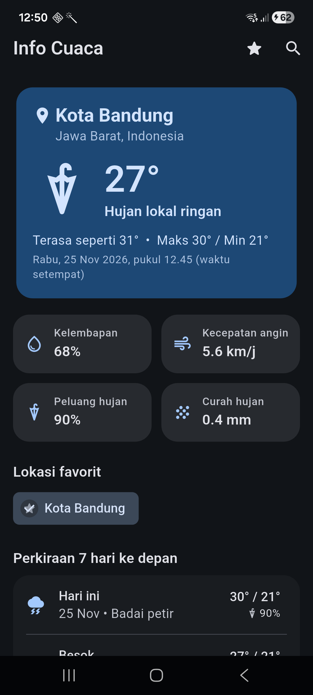
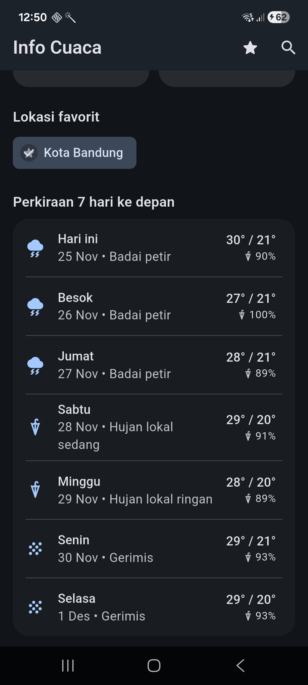
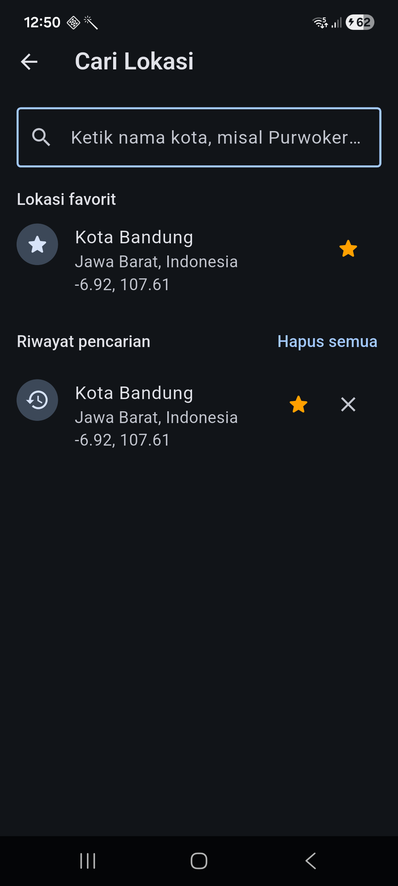
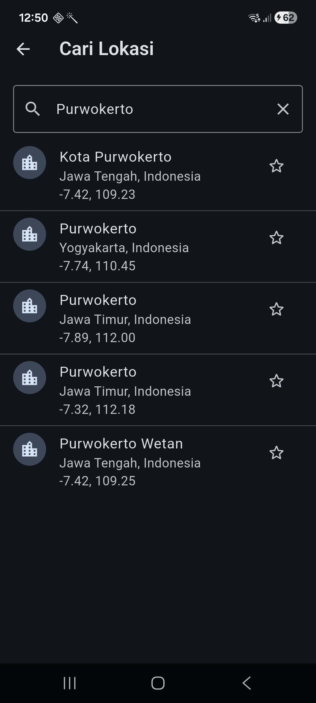
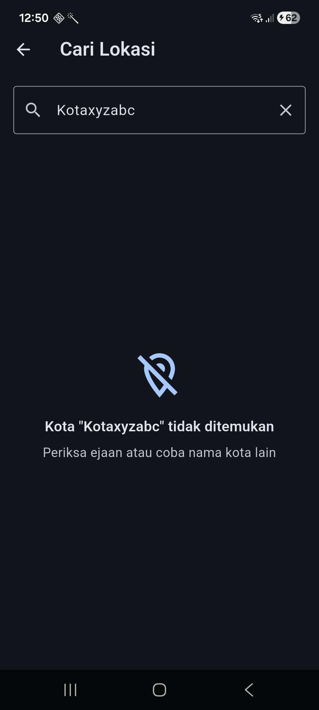

# Info Cuaca — Responsi Flutter

| | |
|---|---|
| Nama | Hafizh Naufal Raditya |
| NIM | H1D024061 |
| Mata kuliah | Praktikum Pemrograman Mobile |
| Video penjelasan | _(link YouTube menyusul)_ |

Aplikasi cuaca Flutter yang mengambil data dari **Open-Meteo** (Geocoding API dan Weather Forecast API). Pengguna bisa mencari kota, melihat cuaca terkini dan perkiraan 7 hari, menyimpan kota sebagai favorit, dan melihat riwayat pencarian. Favorit, riwayat, dan kota terakhir yang dibuka disimpan di **SharedPreferences**, jadi tetap ada saat aplikasi dibuka lagi.

Dibangun dengan Flutter 3.47 / Dart 3.13, arsitektur **MVVM**, state management **Provider** (`ChangeNotifier`), dan package `http`.

## Screenshot

Diambil dari HP Samsung Galaxy A53 (mode gelap mengikuti pengaturan HP).

| Home (Purwokerto) | Home setelah memilih kota | Favorit & perkiraan 7 hari |
|---|---|---|
|  |  |  |

| Search: favorit & riwayat | Search: hasil pencarian | Search: kota tidak ditemukan |
|---|---|---|
|  |  |  |

## Fitur

| Kebutuhan responsi | Implementasi |
|---|---|
| Home / Weather Screen | Nama kota dan wilayah, ikon dan kondisi cuaca, suhu, suhu terasa, suhu maks/min hari ini, kelembapan, kecepatan angin, peluang hujan, curah hujan, perkiraan 7 hari |
| Search / Location Screen | Kolom cari kota, daftar hasil (nama, provinsi, negara, koordinat), pilih kota untuk melihat cuacanya, tombol bintang untuk favorit |
| Pencarian ke API | Setiap pencarian memanggil `GET https://geocoding-api.open-meteo.com/v1/search` (otomatis 0,6 detik setelah berhenti mengetik, atau saat menekan tombol cari) |
| Local storage | Lokasi favorit, riwayat pencarian (maks. 8 kota), dan kota terakhir disimpan dengan SharedPreferences |
| Data tampil lagi saat dibuka | Saat aplikasi dibuka, kota terakhir langsung dimuat; favorit muncul sebagai chip di Home dan daftar di layar pencarian |
| Loading / kosong / error | Indikator loading, pesan "Kota tidak ditemukan", pesan error (tanpa internet, timeout, server bermasalah) dengan tombol **Coba lagi** |
| Theme & Typography | Material 3, `ColorScheme.fromSeed`, tema terang dan gelap mengikuti sistem, `TextTheme` yang diatur ketebalan dan jarak barisnya |
| Responsif | Konten dibatasi lebar maks. 720 px di tengah layar; kotak detail cuaca 2 kolom di HP dan 4 kolom di layar lebar (`LayoutBuilder`); tarik ke bawah untuk memuat ulang |

## Struktur Folder (MVVM)

```
lib/
├── main.dart                         Tema, MultiProvider (mendaftarkan ViewModel), MaterialApp
├── models/                           MODEL — bentuk data
│   ├── city.dart                     City + fromJson/toJson (hasil Geocoding API & data tersimpan)
│   ├── weather.dart                  Weather, CurrentWeather, DailyForecast + fromJson
│   └── weather_condition.dart        Kode cuaca WMO → teks Indonesia + ikon
├── services/                         MODEL — sumber data
│   ├── weather_api_service.dart      HTTP GET ke Open-Meteo, ApiException
│   └── local_storage_service.dart    SharedPreferences: favorit, riwayat, kota terakhir
├── viewmodels/                       VIEWMODEL — state & logika
│   ├── view_status.dart              enum: initial, loading, success, empty, error
│   ├── weather_viewmodel.dart        Kota terpilih + data cuaca
│   ├── search_viewmodel.dart         Kata kunci, hasil pencarian, riwayat
│   └── favorite_viewmodel.dart       Daftar favorit, toggle
├── views/                            VIEW — tampilan
│   ├── home_screen.dart              Home / Weather Screen
│   ├── search_screen.dart            Search / Location Screen
│   └── widgets/
│       ├── current_weather_card.dart Kartu cuaca terkini
│       ├── weather_detail_grid.dart  Kelembapan, angin, peluang hujan, curah hujan
│       ├── daily_forecast_list.dart  Perkiraan harian
│       ├── city_tile.dart            Baris kota (hasil cari / favorit / riwayat)
│       └── state_views.dart          LoadingView, MessageView (kosong & error)
└── utils/
    └── formatter.dart                Format suhu, nama hari, tanggal, jam
test/
├── fake_api.dart                     Server Open-Meteo palsu (MockClient)
├── model_test.dart                   Parsing JSON & kode cuaca
├── viewmodel_test.dart               Status loading/sukses/kosong/error, local storage
└── widget_test.dart                  Alur di layar: Home, cari, favorit, data tersimpan, error
```

## Penerapan MVVM

```
View (Screen/Widget)  ──memanggil──►  ViewModel (ChangeNotifier)  ──memanggil──►  Service  ──►  Open-Meteo / SharedPreferences
        ▲                                     │
        └──── context.watch (rebuild) ◄── notifyListeners()
```

- **Model** (`models/`, `services/`): kelas data dan pengambil data. Tidak tahu apa-apa tentang tampilan.
- **ViewModel** (`viewmodels/`): menyimpan state (`status`, `weather`, `results`, `favorites`, `errorMessage`) dan berisi logika (memanggil service, mengatur status, menyimpan ke local storage). Setelah state berubah, memanggil `notifyListeners()`.
- **View** (`views/`): hanya menampilkan state dari ViewModel dengan `context.watch<...>()` dan meneruskan aksi pengguna dengan `context.read<...>()`. View tidak memanggil API atau SharedPreferences secara langsung.
- Tiga ViewModel didaftarkan sekali di `main.dart` dengan `MultiProvider`, sehingga Home dan Search memakai data yang sama (misalnya bintang favorit di kedua layar selalu sinkron).
- `ViewStatus` membuat tampilan cukup memakai `switch`: `loading` → indikator, `empty` → pesan kosong, `error` → pesan + Coba lagi, `success` → data.
- Respons lama diabaikan dengan penghitung `_requestId`, jadi kalau pengguna mengetik cepat, hasil pencarian lama tidak menimpa hasil yang baru.

## Implementasi API

| API | Endpoint | Parameter |
|---|---|---|
| Geocoding | `GET https://geocoding-api.open-meteo.com/v1/search` | `name`, `count=10`, `language=id`, `format=json` |
| Weather Forecast | `GET https://api.open-meteo.com/v1/forecast` | `latitude`, `longitude`, `current`, `daily`, `timezone=auto`, `forecast_days=7` |

Field yang diminta dan ditampilkan:

| Data | Field API | Ditampilkan di |
|---|---|---|
| Suhu | `current.temperature_2m` | Kartu cuaca (angka besar) |
| Kelembapan | `current.relative_humidity_2m` | Kotak "Kelembapan" |
| Suhu yang dirasakan | `current.apparent_temperature` | "Terasa seperti …" |
| Curah hujan | `current.precipitation` | Kotak "Curah hujan" |
| Kode kondisi cuaca | `current.weather_code`, `daily.weather_code` | Ikon dan teks kondisi (`WeatherCondition`) |
| Kecepatan angin | `current.wind_speed_10m` | Kotak "Kecepatan angin" |
| Siang/malam | `current.is_day` | Ikon matahari atau bulan |
| Suhu maks/min harian | `daily.temperature_2m_max`, `daily.temperature_2m_min` | Kartu cuaca & daftar perkiraan |
| Peluang hujan maks | `daily.precipitation_probability_max` | Kotak "Peluang hujan" & daftar perkiraan |

Alur di `WeatherApiService`:

1. URL dibuat dengan `Uri.https(host, path, parameter)`.
2. `http.get` dengan batas waktu 15 detik.
3. Jika status bukan 200 → `ApiException('Server cuaca sedang bermasalah (kode …)')`.
4. Body di-`jsonDecode` lalu diubah menjadi `City` / `Weather` lewat `fromJson`. Geocoding tidak mengirim `results` jika kota tidak ditemukan, sehingga dikembalikan list kosong (status `empty`).
5. `SocketException` / `ClientException` → "Tidak ada koneksi internet"; `TimeoutException` → "Server terlalu lama merespons".

Semua data cuaca berasal dari API; tidak ada data cuaca statis. Satu-satunya data bawaan adalah koordinat **Purwokerto**, dipakai sebagai kota awal saat aplikasi pertama kali dibuka.

## Local Storage

| Key SharedPreferences | Isi | Dipakai oleh |
|---|---|---|
| `favorite_cities` | List JSON kota favorit | `FavoriteViewModel` |
| `search_history` | List JSON kota yang pernah dipilih dari pencarian (terbaru di atas, maks. 8) | `SearchViewModel` |
| `last_city` | JSON kota yang terakhir dilihat | `WeatherViewModel.init()` |

## Cara Menjalankan

```bash
flutter pub get
flutter run
```

HP atau emulator harus terhubung ke internet.

## Pengujian

```bash
flutter analyze
flutter test
```

- `flutter analyze`: tidak ada masalah.
- `flutter test`: **13 test lulus**. Test memakai `MockClient` dari package `http` sebagai server Open-Meteo palsu, jadi bisa dijalankan tanpa internet.
  - **Model (4):** parsing Geocoding, parsing Forecast (termasuk nilai `null`), kode cuaca WMO, nama hari.
  - **ViewModel (5):** request GET dan parameternya, kota terakhir tersimpan, error saat offline, status hasil/kosong/error pencarian, riwayat & favorit tersimpan.
  - **Widget (4):** Home menampilkan data API, alur cari → favorit → pilih kota, data tersimpan muncul saat dibuka lagi, error offline lalu **Coba lagi**.

## Library

| Package | Kegunaan |
|---|---|
| `http` | Request GET ke Open-Meteo |
| `provider` | Menghubungkan ViewModel (`ChangeNotifier`) ke View |
| `shared_preferences` | Local storage favorit, riwayat, kota terakhir |
